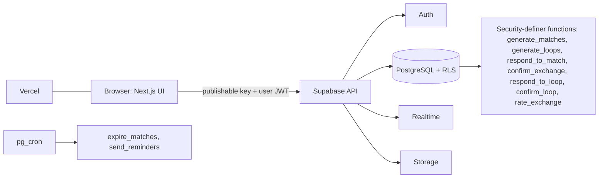
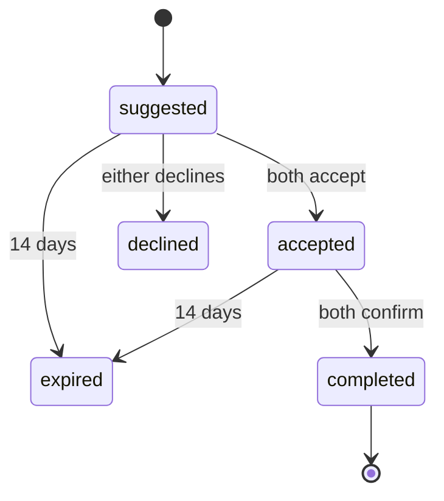
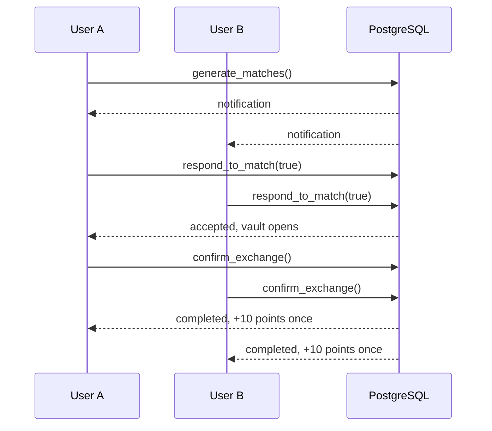
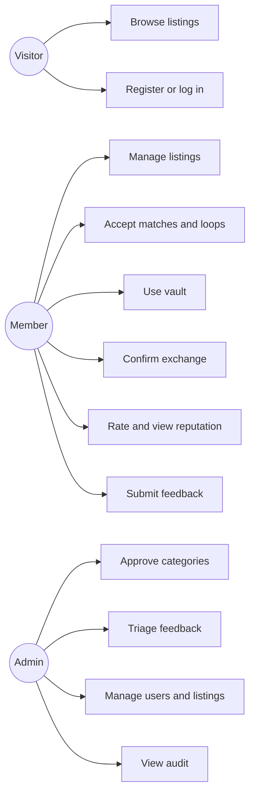
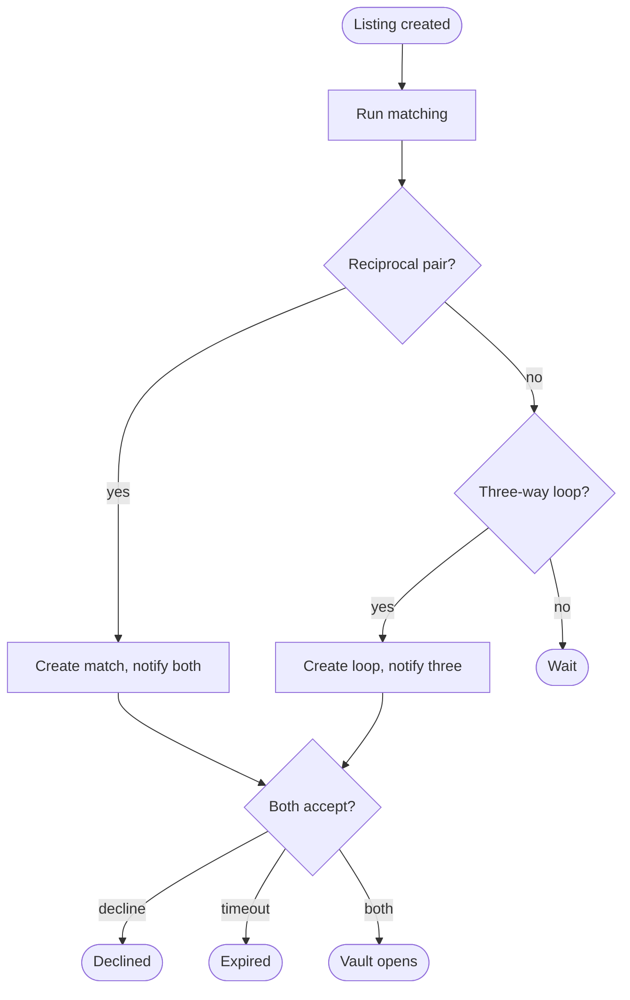
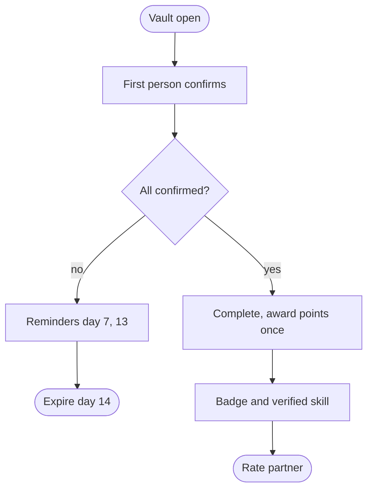
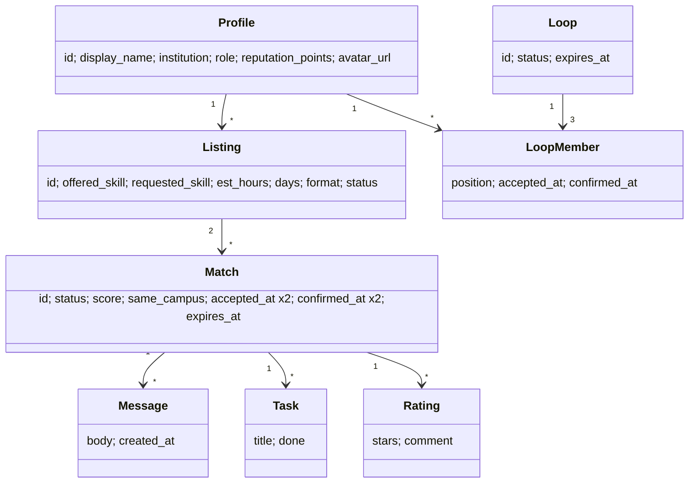
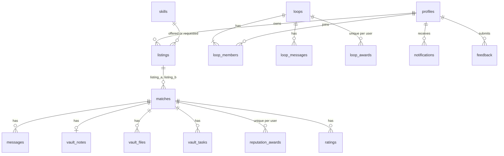
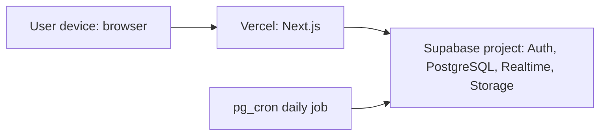

# Xchange-It: The Reciprocal Skill-Barter Ecosystem
**Technical documentation, NPRJ740 Project.** Zandile Shantel Mphago (202314109), Sol Plaatje University.
*Status labels: Implemented / Partial / Deferred. Tests: only those listed in docs/TEST_RESULTS.md were executed. Add your own screenshots, repository URL and deployment URL; none are invented here.*

## 1. Executive summary
Xchange-It is a money-free web platform where tertiary students and early-stage entrepreneurs exchange skills. Its core is a reciprocal Value Loop: a match exists only when each person offers what the other needs, with three-way loops as a fallback. Matching, two-sided acceptance, completion and reputation rules are enforced in PostgreSQL behind row-level security (RLS). The system is built with Next.js, TypeScript and Supabase. SQL logic was tested on PostgreSQL 16 (50 scenarios, 6 security checks) and the matcher by 11 unit tests. It has not yet been tested against live Supabase in an automated way.

## 2. Context, problem and purpose
Many students need professional help (websites, CVs, bookkeeping) but cannot pay, while holding skills others need. Existing marketplaces assume payment. **Purpose:** enable fair, trusted, money-free exchange. **Problem statement:** no accessible mechanism matches people's complementary needs and builds trust without money.

## 3. Measurable success criteria and evaluation
| # | Criterion | Evidence | Status |
|---|---|---|---|
| SC1 | Reciprocal matches only (no one-way) | Unit + SQL tests | Met (tested) |
| SC2 | Reputation only after both confirm, once | SQL T13-T16, T36-T37 | Met (tested) |
| SC3 | Vault private to participants | SQL T6-T8, T43 | Met at database level |
| SC4 | Matching under 2 s for about 10,000 listings | Benchmark | Met for steady state (84-128 ms); first bulk run 9.6 s (not met). Synthetic data, sandbox hardware |
| SC5 | Pages load under 3 s | Not measured | Unverified |
| SC6 | Primary tasks within 5 steps | Design review: listing 3, match 3, completion 4 | Plausible, not user-tested |
| SC7 | Admin functions inaccessible to normal users | SQL T18 and policies | Met at database level |

## 4. Solution scope
**Implemented:** auth (email; Google/GitHub when configured), dashboard, profile with picture, listings (create, edit, deactivate, delete, search, campus filter, hours, weekdays), reciprocal matching with score, three-way loops, two-party accept/decline, private vault (chat, checklist, notes, files up to 10 MB), dual confirmation, reputation, ratings, Starter Badge, verified skills, public profiles, notifications (in-app), feedback portal, admin (stats, categories, feedback triage, users, listing moderation, audit), settings (password, data export), About, Privacy/Terms starter, 404.
**Deferred / limitations:** email and push notifications, rate limiting, CRDT live note editing (notes are last-write-wins), profile field-visibility toggles, loop checklist/ratings/reminders, Tailwind (plain CSS used), Playwright e2e, accessibility and security audits, live-Supabase automated tests. Terms and Privacy text needs professional review. The 14-week timeline and WBS belong in the project plan, not the app.

## 5. Functional requirements (MoSCoW)
| ID | Requirement | Priority | Status |
|---|---|---|---|
| FR1 | Register, log in, log out, reset password | Must | Implemented |
| FR2 | Google/GitHub OAuth when configured | Should | Implemented (needs provider setup) |
| FR3 | Profile with picture and public view | Must | Implemented |
| FR4 | Listing CRUD with validation and ownership | Must | Implemented |
| FR5 | Reciprocal matching, no same-user, inactive or duplicate | Must | Implemented, tested |
| FR6 | Independent two-party acceptance | Must | Implemented, tested |
| FR7 | Private vault: chat, notes, files, checklist | Must | Implemented (live untested) |
| FR8 | Dual completion confirmation | Must | Implemented, tested |
| FR9 | Reputation, ratings, Starter Badge | Must | Implemented, tested |
| FR10 | Three-way loops | Could | Implemented, tested |
| FR11 | Match score and campus matching | Could | Implemented, tested |
| FR12 | Hours fairness label | Could | Implemented |
| FR13 | Verified skills | Could | Implemented, tested |
| FR14 | Feedback portal and admin triage | Should | Implemented |
| FR15 | Admin: users, listings, categories, audit | Should | Implemented (partial depth) |
| FR16 | Expiry at 14 days, reminders day 7 and 13 | Must | Implemented in SQL; needs pg_cron; pair matches only |
| FR17 | Email and push notifications | Won't (this release) | Deferred |

## 6. Non-functional requirements
| ID | Requirement | Verification | Status |
|---|---|---|---|
| NFR1 | Match under 2 s at 10,000 listings | Benchmark script | See SC4 |
| NFR2 | Page load under 3 s | Lighthouse (to run) | Unverified |
| NFR3 | Responsive from 320 px | Manual / screenshots | Designed; partly checked at 390 px |
| NFR4 | WCAG-oriented: labels, focus, contrast, semantic headings | axe DevTools (to run) | Designed, unaudited |
| NFR5 | Access control via RLS on every table | SQL tests | Tested locally |
| NFR6 | No secrets in client | Code review: only anon key used | Met |
| NFR7 | Recent Chrome, Firefox, Safari, Edge | Manual | Unverified |

## 7. Business rules
BR1 A match requires mutual skill fit. BR2 Same-user, inactive, blocked and duplicate pairs are excluded. BR3 Acceptance needs both participants. BR4 Completion needs both confirmations. BR5 Points (10) are awarded once per person per exchange, only on completion. BR6 Pending exchanges expire after 14 days (`expire_matches`). BR7 Reminders at day 7 and 13 (`send_reminders`). BR8 Files max 10 MB and allowed types only. BR9 A skill is verified only by a completed exchange. BR10 Users cannot change their own role or points. BR11 Only participants may rate, once per exchange.

## 8. Acceptance criteria (examples)
Given two users with reciprocal listings, when matching runs, then one match exists for both, with score and explanation. Given one acceptance, status stays suggested. Given both accept, the vault opens. Given one confirmation, no points are awarded. Given both confirm, each gains 10 points once. Given a non-participant, vault data is not returned.

## 9. Architecture and diagrams

Layers: presentation (Next.js pages and components), application logic (SQL functions and `src/lib/matching.ts`), data (PostgreSQL). *Deviation:* there is no separate server API layer; the database functions act as the trusted server logic.

## 10. Data dictionary (key fields)
| Table.field | Type | Notes |
|---|---|---|
| profiles.id | uuid PK | = auth.users.id |
| profiles.role | text | user or admin; users cannot change it (RLS) |
| profiles.reputation_points | int | changed only by SQL functions |
| listings.est_hours | numeric(4,1) | 0 to 200 |
| listings.days | text[] | subset of mon..sun; empty = flexible |
| matches.status | text | suggested, accepted, declined, expired, completed |
| matches.score | int | format 30 + weekdays 30 + city 20 + campus 20 |
| matches unique index | partial | one active match per listing pair |
| reputation_awards PK | (match_id, user_id) | prevents duplicate awards |
| notifications unique | (user, match, kind) | prevents duplicates |
| vault_files.size_bytes | int | at most 10,485,760 |
| loops.key | text unique | ordered listing ids; prevents duplicate loops |

## 11. Role-permission matrix
| Action | Visitor | Member | Participant | Admin |
|---|---|---|---|---|
| Browse active listings | Yes | Yes | Yes | Yes |
| Create, edit own listings | No | Yes | Yes | Yes (plus moderate any) |
| Accept, confirm own side | No | No | Yes | No |
| Read vault, messages, files | No | No | Yes | No |
| Run matching | No | Yes | Yes | Yes |
| Run expiry and reminders | No | No | No | Database owner / cron only |
| Approve categories, triage feedback, read audit, manage users | No | No | No | Yes |

## 12. Security controls
| Control | Where | Tested |
|---|---|---|
| Supabase Auth (no custom password storage) | Auth | Not locally |
| RLS on every table and bucket | Migrations | Yes (SQL) |
| Role and points cannot be self-edited | profiles policy | Yes |
| Privileged functions restricted by role | 0005 | Yes |
| Participant-only vault | RLS + functions | Yes |
| Input limits (CHECK constraints) and client validation | DB + UI | Partly |
| XSS: React escapes output; no raw HTML | UI | Review only |
| Only publishable key in browser; `.env.local` git-ignored | Config | Review |
| Not implemented: rate limiting, WAF, audit, certification | n/a | n/a |

## 13. Technology stack
| Layer | Technology |
|---|---|
| UI | Next.js 14, React 18, TypeScript, plain CSS |
| Backend services | Supabase: PostgreSQL, Auth, Realtime, Storage |
| Logic | SQL/PLpgSQL functions, `src/lib/matching.ts` |
| Tests | Vitest, SQL scenario scripts |
| Hosting | Vercel (planned) |

## 14. Key decisions
1. Rules live in the database so clients cannot bypass them. 2. One `matches` row tracks both sides' acceptance and confirmation. 3. Notes are saved text, not CRDT. 4. Plain CSS instead of Tailwind to ship faster. 5. Score weights are a design choice, not empirically validated.

## 15. Repository structure
`src/app/*` pages; `src/components` shared UI; `src/lib` Supabase client and matcher; `supabase/migrations/0001-0005` schema and rules; `supabase/tests` SQL tests and benchmark; `docs` documentation; `run_sql_tests.sh` test runner.

## 16. API and integration notes
Client calls PostgREST tables under RLS and RPC functions: `generate_matches`, `generate_loops`, `respond_to_match`, `confirm_exchange`, `respond_to_loop`, `confirm_loop`, `rate_exchange`. Storage buckets: `vault` (private), `avatars` (public read). Realtime on `messages`, `loop_messages`, `vault_tasks`. OAuth requires provider credentials in Supabase.

## 17. Setup and deployment
See README.md. Vercel: import the repository, set `NEXT_PUBLIC_SUPABASE_URL` and `NEXT_PUBLIC_SUPABASE_ANON_KEY`, add the Vercel URL to Supabase redirect URLs.

## 18. Screenshots to capture (from your running app)
Landing, login/register, dashboard, listing form, match results, vault, confirmation flow, reputation, feedback, admin, a validation error, a completed exchange.

## 19. References (APA 7; verify before submission)
Supabase. (n.d.). *Row Level Security*. https://supabase.com/docs/guides/database/postgres/row-level-security
Supabase. (n.d.). *Auth*. https://supabase.com/docs/guides/auth
Vercel. (n.d.). *Next.js documentation*. https://nextjs.org/docs
The PostgreSQL Global Development Group. (n.d.). *PostgreSQL documentation*. https://www.postgresql.org/docs/
W3C. (2018). *Web Content Accessibility Guidelines (WCAG) 2.1*. https://www.w3.org/TR/WCAG21/
